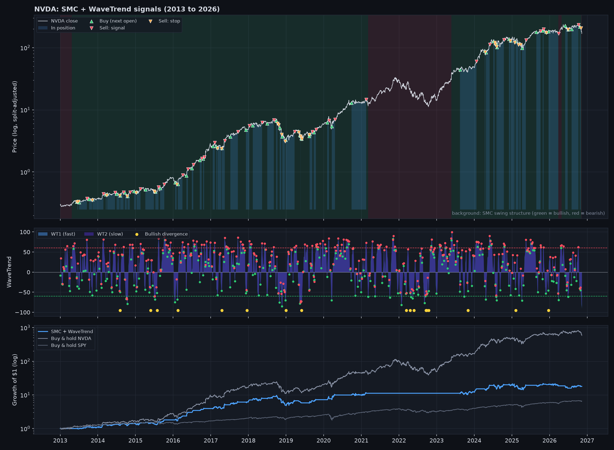
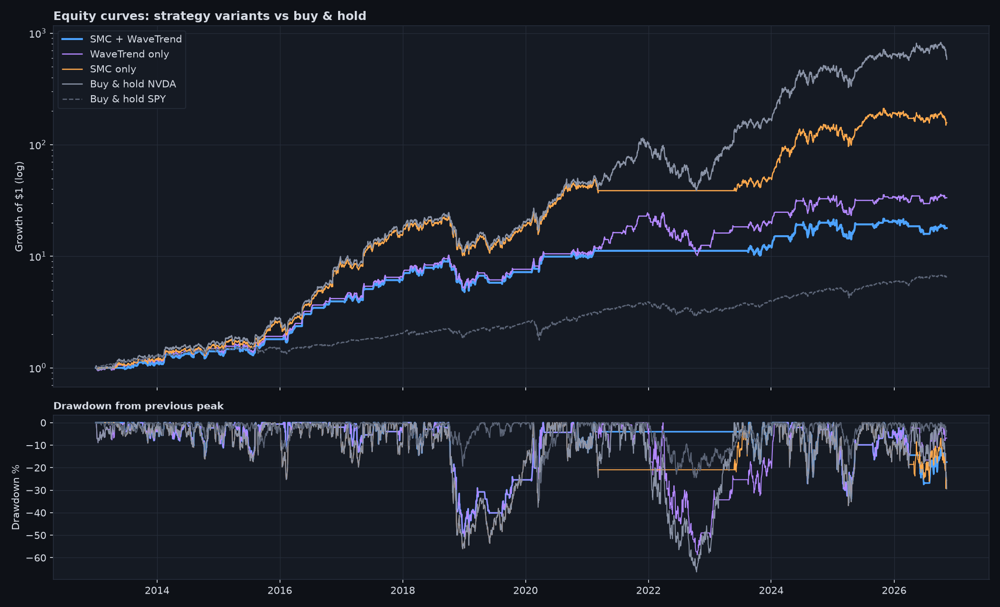
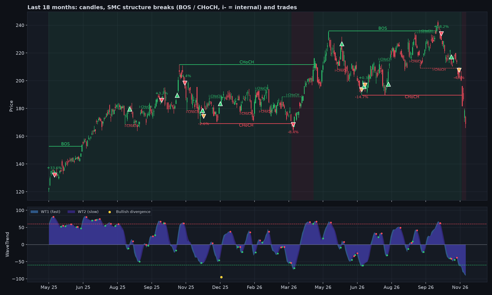
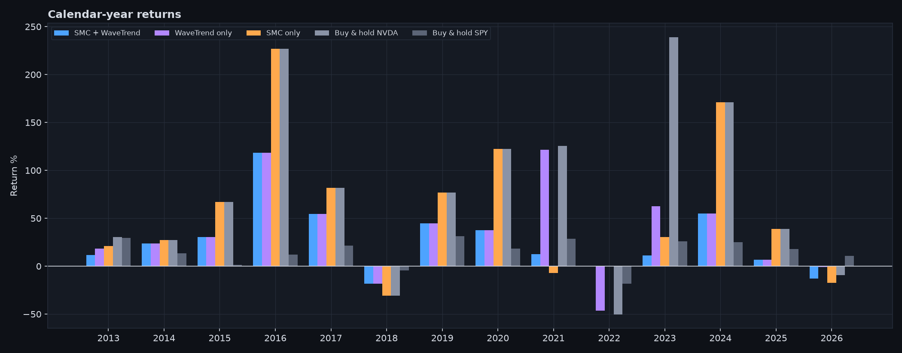

# NVDA: Smart Money Concepts + WaveTrend backtest

A rule-based trading system built from two popular TradingView indicators, ported from Pine Script to Python,
backtested on NVIDIA daily data (2013 to 2026) and compared with buy & hold.

The goal was not to find a money printer. The goal was to take two indicators that look convincing on a chart,
turn them into exact, testable rules, and measure honestly what they add. That includes testing each part on its
own and checking that the code never uses future data.

## In plain English (no trading background needed)

- **What it is:** a program that decides, day by day, whether to own NVIDIA stock or hold cash, using two chart
  tools that traders use. A *backtest* replays the last 14 years of real prices and records what would have
  happened if those rules had been followed exactly.
- **What it's compared with:** *buy & hold*, which means buying once in 2013 and never selling. That is the simplest
  possible approach, and any trading system has to beat it to be worth the effort.
- **The result:** the system turned $1 into about $18 (23% a year). Simply holding NVIDIA turned $1 into about
  $580 (58% a year). **The system lost to buy & hold**, which is the honest and common outcome for a stock that rose
  this much.
- **What it did well:** it avoided the worst crashes. In 2022 NVIDIA fell 50% while the system made 0%, because it
  had already moved to cash. Its worst fall from a peak (*drawdown*) was smaller than buy & hold's (−51% vs −66%).
- **What the project shows:** turning a visual idea into exact rules in Python, testing it fairly (realistic trading
  costs, no peeking at future prices, automated tests that prove it), and reporting the result honestly with charts.



**▶ [Open the interactive project page](https://ivangeorgiev123.github.io/nvda-smc-wavetrend-backtest/)** (plain-English
summary + the interactive chart, nothing to install).

**Interactive chart offline:** `results/interactive_chart.html` (open in a browser). Hover any buy/sell to see the
trade result, zoom with the 6M / 1Y / 3Y / 5Y buttons or by dragging, and the strategy and buy & hold lines
restart at $1 from the first visible day so any period can be compared directly.

**One-page summary for non-traders:** `site/index.html` (rebuild with `python site/build_site.py` after `run.py`).

## The idea in one paragraph

**Smart Money Concepts (SMC)** reads market structure: when price closes above the last swing high, the trend is
bullish (a *break of structure*, BOS, or a *change of character*, CHoCH, if the trend was bearish before).
**WaveTrend** is a momentum oscillator: when its fast line crosses above its slow line below zero, a pullback is
likely ending. The system uses SMC as the **trend filter** and WaveTrend as the **timing trigger**: it only buys
pullbacks inside a bullish structure.

## Rules (long only, daily bars)

| | Rule |
|---|---|
| **Trend filter** | SMC swing structure (50-bar pivots) is bullish |
| **Entry** | WaveTrend bullish cross with WT2 ≤ 0, **or** a WaveTrend bullish divergence (bottom ≤ −40) |
| **Exit: take profit** | WaveTrend bearish cross with WT2 ≥ 60 (overbought) |
| **Exit: trend change** | SMC swing structure turns bearish |
| **Exit: stop** | Close below the latest SMC internal (5-bar) swing low at entry, or the 10-day low if price is already below it |
| **Execution** | Signal at the close, fill at the **next day's open**, 0.10% cost per fill, 100% of equity, no leverage |

All parameters are the indicators' **default TradingView settings**. Nothing was optimised on this data.

## Results (2013-01-02 to 2026-11-10)

| Strategy | CAGR | Max drawdown | Sharpe | Time in market | Trades | Win rate | Profit factor |
|:--|--:|--:|--:|--:|--:|--:|--:|
| **SMC + WaveTrend** | **23.2%** | **−50.6%** | 0.88 | 43.9% | 67 | 50.7% | 2.63 |
| WaveTrend only | 28.8% | −58.7% | 0.93 | 55.5% | 89 | 49.4% | 2.44 |
| SMC only | 44.1% | −56.0% | 1.13 | 81.1% | 3 | 66.7% | — |
| Buy & hold NVDA | 58.4% | −66.3% | 1.24 | 100% | — | — | — |
| Buy & hold SPY | 14.5% | −33.7% | 0.89 | 100% | — | — | — |

Split check (same rules, no re-tuning):

| Period | Strategy CAGR | Strategy max DD | Buy & hold CAGR | Buy & hold max DD |
|:--|--:|--:|--:|--:|
| 2013-01 to 2019-12 | 33.1% | −50.6% | 51.7% | −56.0% |
| 2019-12 to 2026-11 | 14.0% | −34.0% | 65.0% | −66.3% |

Full tables: [`results/summary.md`](results/summary.md), every trade: [`results/trades.csv`](results/trades.csv).



## What I learned

1. **Nothing beat buy & hold on NVDA.** NVDA rose ~580x in this period. A system that is out of the market more than
   half the time cannot keep up with a stock in a historic uptrend. Every timing rule pays for its safety with
   missed upside.
2. **The SMC filter does its job as a risk filter, not a return booster.** Compared with WaveTrend alone it cut
   the max drawdown (−50.6% vs −58.7%) and volatility, and it sat out the whole of 2022 (0% vs −46% for
   WaveTrend only and −50% for buy & hold). It also skipped most of the 2023 rally, so the total return was lower.
3. **In the second half the strategy halved the drawdown** (−34% vs −66%) but earned 14% a year instead of 65%.
   Whether that trade-off is worth it depends on the investor. It is not a free lunch.
4. **The edge is in the payoff, not the hit rate.** Only ~51% of trades win, but winners are larger than losers
   (profit factor 2.6, average trade +5.4%).
5. **Stops do not protect against gaps.** In November 2018 NVDA gapped down ~19% on earnings, straight through
   the stop: the worst trade lost 23%. A daily-bar system cannot exit between the close and the next open.
6. **The 50-bar swing structure is slow.** In late 2018 it stayed "bullish" while price was already falling,
   so the system kept buying dips into a crash. Faster structure would react sooner but trade more noise.





## How look-ahead bias is avoided

- Indicators are ported **bar by bar** from the Pine Script source, so every value at day *i* uses days 0..*i* only.
  SMC pivots are confirmed 50 (or 5) bars after they happen, and divergences 2 bars after the low, exactly as
  TradingView prints them.
- Orders are decided at the close and filled at the **next open**.
- `tests/test_no_lookahead.py` recomputes every indicator and signal on data cut off at five dates and checks
  that no historical value changes when the future is removed. Other tests check next-open fills, costs and the stop.

```
pytest -q        # 7 passed (run `python run.py` once first so the price data is cached)
```

## Project structure

```
backtester/
  data.py        download + cache daily prices (yfinance)
  wavetrend.py   WaveTrend, crosses, divergences, money flow
  smc.py         Smart Money Concepts market structure (BOS / CHoCH, swing + internal pivots)
  strategy.py    rules -> entry / exit / stop signals for each variant
  engine.py      long-only backtester (next-open fills, costs, stops, trade log)
  metrics.py     CAGR, drawdown, Sharpe, Sortino, Calmar, win rate, profit factor
  plots.py       charts
run.py           runs everything and writes results/
tests/           look-ahead and engine tests
```

## Run it

On Windows you can simply double-click `run.bat`: it creates the environment on the first run, runs the
backtest and opens the results folder. Or from a terminal:

```bash
python -m venv .venv
.venv/Scripts/activate          # Windows  (source .venv/bin/activate on macOS/Linux)
pip install -r requirements.txt
python run.py                   # NVDA vs SPY, 2013 to today
python run.py --ticker AMD      # any Yahoo Finance ticker
pytest -q
```

## Limitations and next steps

- **One stock, chosen after the fact.** NVDA is the best-performing large stock of the decade, so this is a hard
  benchmark and a biased sample. Next: run the same rules on a broad universe (e.g. S&P 500 members at the time).
- **No parameter search.** Defaults only. A fair tuning would need walk-forward optimisation, not one in-sample fit.
- **All-in sizing.** Volatility-based position sizing or a partial core position (e.g. 50% buy & hold + 50% system)
  would likely give a better risk/return mix than all-or-nothing.
- **Gap risk.** An earnings-date filter (no new entries just before earnings) is an obvious improvement.

## Credits

- **Smart Money Concepts**: © LuxAlgo, licensed [CC BY-NC-SA 4.0](https://creativecommons.org/licenses/by-nc-sa/4.0/).
  `backtester/smc.py` is a Python port of its market-structure logic and is shared under the same licence.
- **WaveTrend Oscillator**: LazyBear. Divergence logic and the Cipher B layout: VuManChu Cipher B Divergences
  (with code from RicardoSantos, LucemAnb and others on TradingView).
- Price data: Yahoo Finance via `yfinance`.

This is an educational project, not investment advice.
